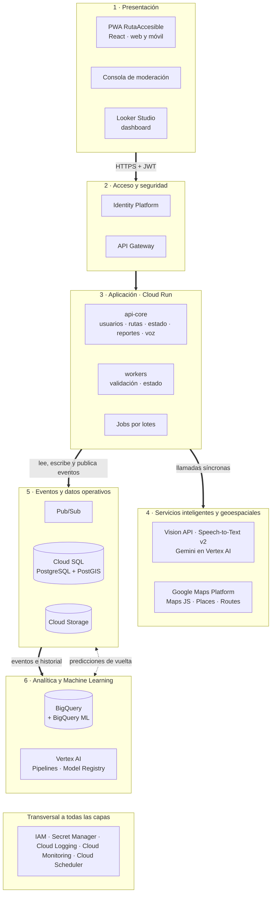
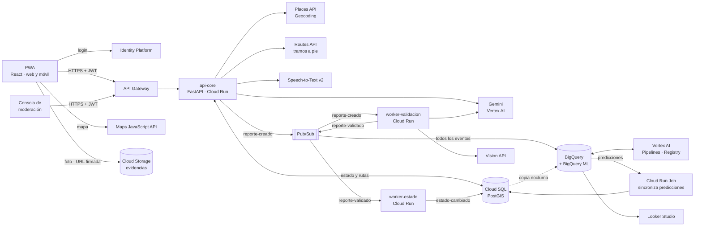
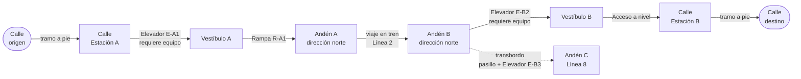

# 3–5. Arquitectura general, diagrama y componentes

## 3. Arquitectura general del sistema

### 3.1 Estilo arquitectónico

RutaAccesible usa un **monolito modular desplegado en Cloud Run, más trabajadores asíncronos dirigidos por eventos (Pub/Sub)**. Se eligió este estilo, en lugar de microservicios desde el inicio, por tres razones:

1. **Equipo y plazo pequeños**: un solo servicio de API (`api-core`) con módulos bien separados (usuarios, rutas, estado, reportes, voz) es más fácil de construir, probar y explicar.
2. **Fronteras listas para separarse**: cada módulo tiene su propio paquete, sus tablas y sus eventos; si uno crece (por ejemplo, el motor de rutas), se extrae a su propio servicio de Cloud Run sin rediseñar.
3. **Serverless de punta a punta**: Cloud Run escala a cero fuera de horario y escala horizontalmente en picos, sin administrar servidores.

### 3.2 Dos caminos de datos: caliente y frío

La arquitectura separa explícitamente lo que debe responder en segundos de lo que puede procesarse en minutos u horas:

| Camino | Qué incluye | Requisito | Cómo se cumple |
|---|---|---|---|
| **Caliente (síncrono)** | Calcular una ruta, consultar el estado de una estación, interpretar una orden de voz | Respuesta p95 < 2–3 s | El grafo de la red vive en memoria del servicio; el estado de los equipos y las predicciones ya están **precalculados** en Cloud SQL; no se entrena ni se llama a modelos pesados en esta ruta. |
| **Frío (asíncrono)** | Validar evidencias con IA, recalcular estados, cargar datos a BigQuery, entrenar y ejecutar modelos | Minutos a horas | Pub/Sub desacopla; trabajadores en Cloud Run; trabajos programados con Cloud Scheduler. |

Este principio es clave para la escalabilidad: **el ML enriquece el camino caliente con resultados precalculados, pero no lo bloquea**.

### 3.3 Capas

1. **Presentación**: PWA en React (personas usuarias), consola de moderación dentro de la misma PWA (roles moderador/administrador) y Looker Studio (dashboard analítico).
2. **Acceso y seguridad**: Identity Platform (identidad de personas), API Gateway (validación de JWT, cuotas, límite de peticiones).
3. **Aplicación**: `api-core` (FastAPI) y trabajadores (`worker-validacion`, `worker-estado`) en Cloud Run; tareas por lotes en Cloud Run Jobs.
4. **Eventos**: Pub/Sub con tópicos de dominio (`reporte-creado`, `reporte-validado`, `estado-cambiado`, `consulta-ruta`).
5. **Datos operativos**: Cloud SQL (PostgreSQL + PostGIS) como fuente de verdad del estado actual; Cloud Storage para fotografías.
6. **Analítica y ML**: BigQuery (historial, indicadores, entrenamiento con BigQuery ML) y Vertex AI (Pipelines, Model Registry, Gemini).
7. **IA administrada**: Vision API, Speech-to-Text v2, Gemini.
8. **Geoespacial**: Google Maps Platform (mapa, búsqueda de lugares, tramos a pie).
9. **Plataforma transversal**: IAM, Secret Manager, Cloud Logging, Cloud Monitoring, Cloud Scheduler.

---

## 4. Diagrama de arquitectura

La arquitectura se presenta en dos vistas complementarias: una **por capas**, para entender la organización general, y otra **de componentes**, para seguir el flujo real de información.

### Vista A — por capas

### Vista B — componentes y flujo de información

**Cómo leer la vista B**

- El **camino caliente** (síncrono) es `PWA → API Gateway → api-core → Cloud SQL / Places / Routes / Speech-to-Text / Gemini`: es lo que ocurre mientras la persona espera una ruta o una respuesta de voz.
- El **camino frío** (asíncrono) empieza cuando `api-core` publica `reporte-creado` en Pub/Sub: `worker-validacion` verifica la evidencia con Vision API y Gemini, publica `reporte-validado`, y `worker-estado` actualiza el estado del equipo en Cloud SQL.
- **Todos los eventos** llegan a BigQuery por una suscripción directa de Pub/Sub (sin Dataflow), y una copia nocturna de Cloud SQL completa el historial.
- BigQuery ML y Vertex AI entrenan y predicen por lotes; un Cloud Run Job copia las **predicciones de falla** a Cloud SQL, donde el motor de rutas las lee sin latencia adicional.
- Los servicios transversales (IAM, Secret Manager, Cloud Logging/Monitoring y Cloud Scheduler, que dispara los Jobs y el reentrenamiento) se omiten en la vista B para que se lea con claridad; aparecen en la vista A y en los documentos 05 y 07.

### 4.1 Modelo de la red como grafo

El motor de rutas no es una caja negra de Google: es un grafo propio construido a partir del GTFS de la CDMX y del inventario de equipos. Cada estación se descompone en **niveles** (calle, vestíbulo, andén por dirección) y las conexiones verticales quedan ligadas a un equipo concreto:

Las aristas que dependen de un equipo (elevador, rampa, salvaescaleras) heredan su estado dinámico. Si el elevador E-B2 está en falla confirmada, la arista desaparece para los perfiles que lo necesitan y el algoritmo busca otra salida, otra estación o otra línea.

### 4.2 Cómo se elige la "ruta más accesible"

El cálculo combina **restricciones duras** y una **función de costo**.

**Paso 1 – Restricciones duras (filtro de seguridad).** Para el perfil de la persona se eliminan del grafo:

- aristas cuyo equipo requerido está en `FALLA_CONFIRMADA` o la estación está cerrada;
- aristas que el perfil no puede recorrer (por ejemplo, escaleras para silla de ruedas, pendientes mayores a la tolerancia declarada);
- tramos a pie más largos que la distancia máxima del perfil.

**Paso 2 – Costo aditivo por arista.** Sea $p_k$ la probabilidad efectiva de que el equipo $k$ **no** funcione (combina el estado observado, la predicción del modelo y la antigüedad del dato). La probabilidad de que una ruta $r$ se complete sin barreras es:

$$P_{\text{éxito}}(r) = \prod_{e \in r} \prod_{k \in \text{req}(e)} (1 - p_k)$$

Maximizar ese producto equivale a minimizar $-\ln P_{\text{éxito}}(r) = \sum_{e}\sum_{k} -\ln(1-p_k)$, que es **aditivo por arista**. Eso permite usar algoritmos clásicos de caminos mínimos (Dijkstra y, para alternativas, el algoritmo de Yen de *k* caminos más cortos) con el peso:

$$w(e) = \lambda_{\text{perfil}} \sum_{k \in \text{req}(e)} -\ln(1-p_k) \;+\; \alpha\, t_e \;+\; \beta\, \text{transbordo}_e \;+\; \gamma\, d^{\text{pie}}_e \;+\; \delta\, u_e$$

donde $t_e$ es el tiempo, $d^{\text{pie}}_e$ la distancia a pie, $u_e$ una penalización por incertidumbre (equipos sin verificación reciente) y $\lambda, \alpha, \beta, \gamma, \delta$ son pesos que dependen del perfil. Con $\lambda$ grande respecto de $\alpha$, la accesibilidad domina y el tiempo sólo desempata.

**Paso 3 – Índice de Accesibilidad de Ruta (IAR).** Para cada alternativa se reporta $\text{IAR} = 100 \cdot P_{\text{éxito}}(r)$, junto con la categoría (alta ≥ 90, media 70–89, baja < 70), los equipos críticos, su última verificación y un plan B (estación o salida alternativa más cercana a cada punto crítico).

**Paso 4 – Si no hay ruta segura**, el sistema **no** muestra silenciosamente una ruta riesgosa: informa que no encontró una ruta accesible confiable, muestra la mejor opción con sus riesgos explícitos y sugiere alternativas (otro horario con mayor disponibilidad, otro sistema de transporte, contacto de asistencia).

---

## 5. Componentes y responsabilidades

### 5.1 Mapa de módulos funcionales a componentes

| Módulo funcional | Componentes técnicos | Responsabilidad principal |
|---|---|---|
| **A. Gestión de usuarios** | Identity Platform + módulo `usuarios` de `api-core` + Cloud SQL | Registro e inicio de sesión; perfil y preferencias de movilidad; consentimiento para datos sensibles; reputación como reportante. |
| **B. Planificador inteligente de rutas** | Módulo `rutas` de `api-core` (grafo en memoria con NetworkX) + Cloud SQL/PostGIS + Places API + Routes API + Maps JavaScript API | Resolver origen y destino, encontrar estaciones accesibles cercanas, calcular y comparar alternativas, explicar el IAR y dibujar el trayecto. |
| **C. Reportes comunitarios** | Módulo `reportes` de `api-core` + Cloud Storage + Pub/Sub + `worker-validacion` (Vision API, Gemini) + módulo `estado` | Recibir reportes con foto y ubicación, verificarlos, deduplicarlos, actualizar el estado de los equipos y exponerlos a otras personas. |
| **D. Motor de recomendaciones con ML** | BigQuery (features, BigQuery ML) + Vertex AI (Pipelines, Model Registry) + Cloud Run Job de sincronización + función de costo del módulo `rutas` | Predecir fallas por equipo y franja horaria, alimentar el costo de las rutas, identificar patrones y horarios de mayor disponibilidad. |
| **E. Asistente de voz** | Módulo `voz` de `api-core` + Speech-to-Text v2 (Chirp 3) + Gemini + Places API + síntesis de voz del navegador | Convertir voz a texto, extraer la intención (origen, destino, restricciones), pedir aclaraciones y responder con instrucciones accesibles. |
| **F. Dashboard administrativo** | Looker Studio sobre BigQuery (vistas `gold`) + consola de moderación en la PWA | Indicadores de fallas, zonas críticas, demanda accesible por horario, desempeño del modelo, y moderación de reportes ambiguos. |

### 5.2 Descripción de cada componente

| Componente | Tecnología | Entradas | Salidas | Notas de diseño |
|---|---|---|---|---|
| **PWA RutaAccesible** | React + TypeScript + Vite, instalable | Interacción, GPS, cámara, micrófono | Peticiones a la API, mapa | Cumple WCAG 2.2 AA; funciona con lector de pantalla; guarda la última ruta para consultarla sin señal dentro del Metro. |
| **API Gateway** | Google API Gateway | Peticiones HTTPS con JWT | Peticiones validadas a Cloud Run | Valida el token emitido por Identity Platform, aplica cuotas por consumidor y limita la tasa de reportes para evitar abuso. |
| **api-core** | FastAPI en Cloud Run | Peticiones REST | Respuestas JSON, eventos Pub/Sub | Monolito modular; carga el grafo en memoria al arrancar; mantiene una instancia mínima activa para evitar arranques en frío. |
| **worker-validacion** | Cloud Run (push de Pub/Sub) | Evento `reporte-creado` | Puntaje de confianza, evento `reporte-validado` | Llama a Vision API y Gemini, verifica geolocalización y duplicados, difumina rostros antes de publicar la foto. |
| **worker-estado** | Cloud Run (push de Pub/Sub) | Eventos `reporte-validado`, datos oficiales | Estado actualizado, evento `estado-cambiado` | Implementa el estimador bayesiano del estado de cada equipo, con decaimiento temporal y umbrales asimétricos (ver documento 04). |
| **Cloud Run Jobs** | Contenedores por lotes | Disparo de Cloud Scheduler | Tablas actualizadas | Carga y validación del GTFS, copia de predicciones BigQuery → Cloud SQL, recálculo de decaimiento. |
| **Cloud SQL (PostgreSQL + PostGIS)** | Base relacional administrada | Escrituras de `api-core` y trabajadores | Lecturas operativas | Fuente de verdad del **estado actual**; consultas espaciales ("estaciones accesibles a menos de 800 m"). |
| **Cloud Storage** | Bucket privado | Subidas por URL firmada | Fotos originales y versiones redactadas | Sin acceso público; ciclo de vida que elimina originales a los 90 días. |
| **Pub/Sub** | Mensajería administrada | Eventos de dominio | Entregas a trabajadores y a BigQuery | Desacopla picos de carga; tópicos con cola de mensajes fallidos (*dead-letter*). |
| **BigQuery** | Almacén analítico | Eventos, copia diaria de Cloud SQL, GTFS, afluencia | Indicadores, *features*, predicciones | Capas bronze/silver/gold + dataset `ml`; tablas particionadas por fecha. |
| **Vertex AI** | Pipelines, Model Registry, Gemini | Datos de BigQuery, prompts | Modelos versionados, predicciones, texto estructurado | Orquesta reentrenamiento y evaluación; da acceso a Gemini para lenguaje y visión. |
| **Vision API** | API preentrenada | Imagen | Etiquetas, objetos, texto (OCR), rostros, contenido inapropiado | Primera línea de verificación visual y de privacidad. |
| **Speech-to-Text v2** | Chirp 3 | Audio corto | Texto | Adaptación de voz con los nombres de las estaciones (Tlatelolco, Iztacalco, Popotla…). |
| **Google Maps Platform** | Maps JS, Places, Geocoding, Routes | Texto de lugares, coordenadas | Mapa, coordenadas, tramos a pie | Routes API se usa **sólo** para tramos a pie; el ruteo en transporte es propio. |
| **Looker Studio** | Tableros sobre BigQuery | Vistas `gold` | Dashboard | Sin costo de licencia; acceso restringido a cuentas institucionales. |
| **Identity Platform** | Identidad de personas usuarias | Credenciales | JWT | IAM controla identidades de **servicios**; Identity Platform, las de **personas**. |
| **Secret Manager / IAM / Logging / Monitoring / Scheduler** | Plataforma | — | — | Ver documentos 05 y 07. |
