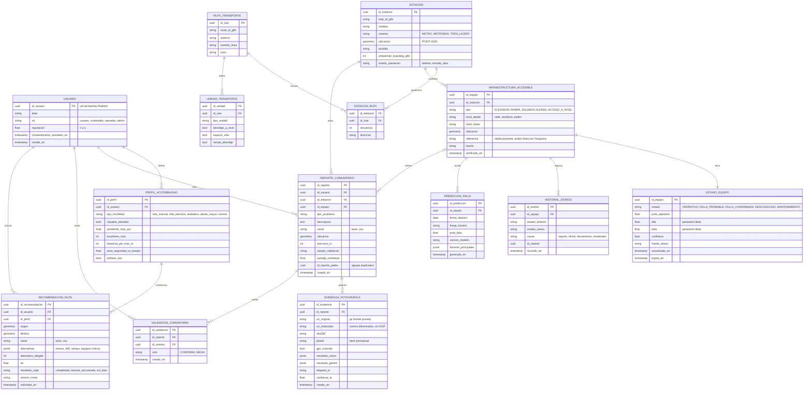

# 6. Arquitectura de datos y entidades principales

## 6.1 Fuentes de datos

| Fuente | Contenido | Frecuencia | Uso |
|---|---|---|---|
| **GTFS estático CDMX** (datos.cdmx.gob.mx) | Agencias, líneas, paradas, viajes, horarios, trazos; indicador `wheelchair_boarding` por parada | Irregular (última descarga registrada por MobilityData: marzo 2026) | Construcción del grafo; accesibilidad base de cada estación. |
| **Inventario de equipos** (curado por el proyecto) | Elevadores, rampas, salvaescaleras y accesos a nivel por estación, con qué niveles conectan | Inicial + mantenimiento comunitario | Aristas dependientes de equipo en el grafo. No existe una fuente pública consolidada, por eso es un activo propio. |
| **Reportes comunitarios** | Fallas, restablecimientos, obstáculos, fotos | Continua | Actualización del estado; entrenamiento de modelos. |
| **Afluencia diaria del Metro** (datos abiertos CDMX) | Entradas por estación y día | Mensual/trimestral | *Feature* de carga de uso; normalización del sesgo de reporte. |
| **Avisos oficiales** (STC, Metrobús) | Cierres de estaciones, obras, equipos en mantenimiento | Eventual | Estado con máxima prioridad de fuente; carga manual en el MVP. |
| **GTFS-Realtime de Metrobús** (futuro) | Llegadas en tiempo real | Segundos | Tiempos de espera reales (versión futura). |

## 6.2 Modelo entidad-relación

> Nota: en el enunciado, "Ruta" puede significar dos cosas distintas. Aquí se separan en **RUTA_TRANSPORTE** (una línea o servicio del GTFS, por ejemplo "Metro Línea 2") y **RECOMENDACION_RUTA** (el plan de viaje que el sistema calcula para una persona).

## 6.3 Entidades y atributos clave

| Entidad | Propósito | Atributos que más importan | Relaciones |
|---|---|---|---|
| **Usuario** | Identidad mínima dentro del dominio | `rol`, `reputacion`, fecha de consentimiento | 1–N perfiles, reportes, votos, recomendaciones |
| **Perfil de accesibilidad** | Traduce necesidades funcionales a restricciones del grafo | `requiere_elevador`, `pendiente_max_pct`, `distancia_pie_max_m`, `peso_seguridad_vs_tiempo` | Condiciona cada recomendación. Se guardan **necesidades funcionales**, nunca diagnósticos médicos. |
| **Estación** | Nodo físico de la red | `ubicacion` (PostGIS), `sistema`, `wheelchair_boarding_gtfs`, `estado_operacion` | N–M con rutas de transporte; 1–N equipos |
| **Ruta de transporte** | Línea o servicio GTFS | `route_id_gtfs`, `sistema`, `nombre_linea` | Recorre estaciones en una secuencia |
| **Unidad de transporte** | Características del vehículo | `abordaje_a_nivel`, `espacio_silla`, `rampa_abordaje` | Pertenece a una ruta. En el MVP se modela por **tipo de unidad** de cada línea, no por vehículo individual. |
| **Infraestructura accesible** | Equipo que hace posible una conexión entre niveles | `tipo`, `nivel_desde`, `nivel_hasta`, `referencia` | Cada equipo es una arista del grafo. |
| **Estado de equipo** | Estado vigente con su incertidumbre | `estado`, `prob_operativo`, `alfa`, `beta`, `confianza`, `expira_en` | 1–1 con el equipo; el historial guarda cada transición. |
| **Reporte comunitario** | Observación de una persona | `tipo_problema`, `ubicacion`, `estado_validacion`, `puntaje_confianza`, `id_reporte_padre` | Puede referirse a un equipo concreto o sólo a la estación (si la persona no lo identifica, la IA intenta inferirlo). |
| **Evidencia fotográfica** | Prueba visual y su análisis | `uri_original`, `uri_redactada`, `sha256`, `phash`, `etiqueta_ia`, `confianza_ia` | N–1 con el reporte |
| **Validación comunitaria** | Corroboración o refutación por otras personas | `voto` | N–1 con el reporte |
| **Predicción de falla** | Salida del modelo de ML | `fecha_objetivo`, `franja_horaria`, `prob_falla`, `version_modelo`, `factores_principales` | N–1 con el equipo |
| **Recomendación de ruta** | Registro de lo que el sistema propuso y qué pasó | `alternativas`, `alternativa_elegida`, `iar`, `resultado_viaje` | Es la base para medir la seguridad del motor y, en el futuro, para entrenar un modelo de ranking. |

## 6.4 Qué información se almacena en cada servicio

| Servicio | Qué guarda | Por qué ahí | Retención |
|---|---|---|---|
| **Identity Platform** | Correo, proveedor de inicio de sesión, factores de autenticación | Las credenciales nunca tocan la base de la aplicación | Mientras la cuenta exista |
| **Cloud SQL (PostgreSQL + PostGIS)** | Todas las entidades operativas del diagrama: usuarios (sin correo), perfiles, estaciones, equipos, estado actual, reportes, validaciones, predicciones vigentes, recomendaciones recientes | Integridad referencial, transacciones, consultas espaciales y baja latencia para el camino caliente | Recomendaciones con origen/destino exactos: 30 días; luego se agregan y se eliminan |
| **Cloud Storage** | Fotos originales (privadas) y versiones redactadas | Objetos binarios baratos y durables | Originales: 90 días (regla de ciclo de vida); redactadas: mientras el reporte esté vigente + 1 año |
| **Pub/Sub** | Eventos en tránsito | Desacoplamiento | 7 días de retención de mensajes |
| **BigQuery** | Historial completo y datos analíticos, **seudonimizados** | Análisis a gran escala, BigQuery ML, conexión con Looker Studio | Ver capas abajo |
| **Vertex AI** | Artefactos de modelos, metadatos de entrenamiento y evaluación, versiones en Model Registry | Gobierno y trazabilidad de modelos | Todas las versiones en producción + las 5 anteriores |
| **Secret Manager** | Llaves de APIs, contraseña de Cloud SQL, sal para seudonimizar | Nunca en código ni en variables de entorno planas | Rotación periódica |
| **Dispositivo (PWA)** | Perfil local para uso anónimo, última ruta consultada | Privacidad por diseño y uso sin señal | Lo controla la persona usuaria |

### Capas de BigQuery

| Dataset | Contenido | Ejemplos de tablas |
|---|---|---|
| `ra_bronze` | Datos crudos tal como llegan | `gtfs_stops_raw`, `eventos_pubsub_raw`, `afluencia_metro_raw` |
| `ra_silver` | Datos limpios y conformados | `dim_estacion`, `dim_equipo`, `fact_reporte`, `fact_estado_equipo_hist`, `fact_consulta_ruta` |
| `ra_gold` | Indicadores listos para el dashboard | `kpi_disponibilidad_equipo_diaria`, `kpi_mttr_equipo`, `kpi_zonas_criticas`, `kpi_demanda_accesible_hora` |
| `ra_ml` | *Features*, conjuntos de entrenamiento, predicciones, métricas | `features_equipo_dia`, `train_falla_equipo`, `pred_falla_equipo`, `metricas_modelo` |

Las tablas de hechos se **particionan por fecha** y se **agrupan (cluster) por `id_estacion`**, lo que reduce el costo de las consultas típicas del dashboard. En BigQuery el identificador de usuario se reemplaza por un hash con sal (guardada en Secret Manager) y los orígenes/destinos se generalizan a la estación más cercana o a una celda de ~500 m.

### Cómo se mueven los datos entre servicios

1. **Eventos → BigQuery**: cada evento de Pub/Sub se escribe automáticamente en `ra_bronze` mediante una suscripción de BigQuery.
2. **Cloud SQL → BigQuery**: una consulta programada usa *consultas federadas* para copiar cada noche las dimensiones (estaciones, equipos, estado) a `ra_silver`. En una versión futura con más volumen se reemplaza por Datastream (CDC).
3. **BigQuery → Cloud SQL**: un Cloud Run Job copia las predicciones vigentes de `ra_ml.pred_falla_equipo` a la tabla `prediccion_falla` de Cloud SQL.
4. **GTFS → ambos**: un Cloud Run Job descarga, valida y carga el GTFS a `ra_bronze` y actualiza estaciones y rutas en Cloud SQL.
