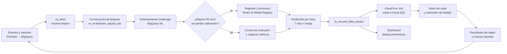
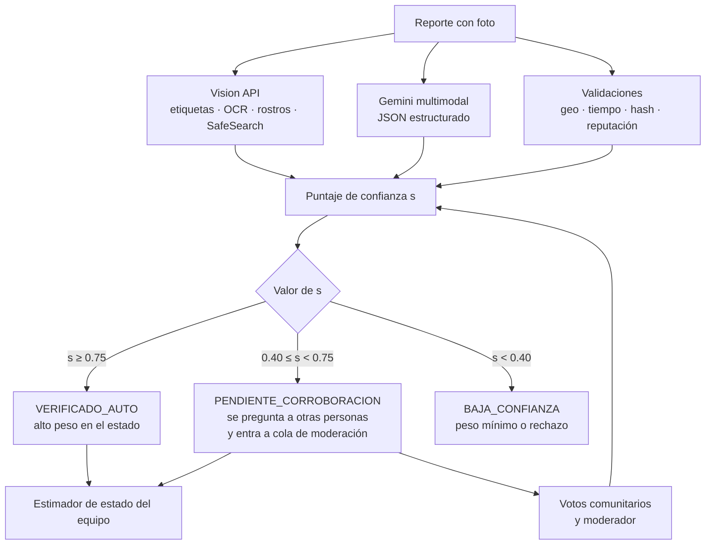

# 7. Integración de Data, Machine Learning e Inteligencia Artificial

Este documento explica qué hace cada servicio de datos e IA, **por qué es necesario** y **cómo se conecta** con el resto. La idea rectora es:

> La IA y el ML **estiman** (qué tan probable es que un elevador funcione, qué dice una foto, qué pidió la persona por voz). Las **decisiones de seguridad** (qué ruta es aceptable) se toman con reglas explícitas que usan esas estimaciones, nunca al revés.

## 7.0 Vista general de los componentes inteligentes

| # | Componente | Tipo | Servicio | Pregunta que responde |
|---|---|---|---|---|
| IA-1 | Verificación de evidencias | Visión por computadora | Vision API + Gemini (multimodal) | ¿La foto muestra de verdad un elevador fuera de servicio o una rampa bloqueada? |
| IA-2 | Puntaje de confianza del reporte | Reglas → modelo supervisado | `worker-validacion` → BigQuery ML | ¿Qué tanto creerle a este reporte? |
| IA-3 | Estimador de estado de equipos | Estadística bayesiana | `worker-estado` | Con todo lo que sé, ¿cuál es la probabilidad de que este elevador funcione **ahora**? |
| ML-1 | Predicción de fallas | Clasificación supervisada | BigQuery ML + Vertex AI | ¿Qué equipos tienen más probabilidad de fallar en los próximos días y en qué franja? |
| ML-2 | Recomendación de rutas | Optimización en grafos con pesos aprendidos | Motor propio + salidas de IA-3 y ML-1 | ¿Qué ruta maximiza la probabilidad de llegar? |
| IA-4 | Voz a texto | Reconocimiento de voz | Speech-to-Text v2 (Chirp 3) | ¿Qué dijo la persona? |
| IA-5 | Comprensión de lenguaje | NLP con modelo generativo | Gemini en Vertex AI | ¿A dónde quiere ir y con qué restricciones? ¿Qué problema describe este reporte escrito? |
| DA-1 | Analítica e indicadores | Data Analytics | BigQuery + Looker Studio | ¿Dónde y cuándo se concentran las fallas? ¿Cuándo hay más demanda accesible? |

---

## 7.1 Google BigQuery — memoria histórica y laboratorio analítico

**Responsabilidad.** BigQuery guarda **todo el historial** (cada reporte, cada cambio de estado, cada consulta de ruta seudonimizada, el GTFS y la afluencia) y es donde se calculan indicadores y se entrenan los modelos tabulares.

**Cómo cumple cada objetivo del enunciado**

| Objetivo | Implementación concreta |
|---|---|
| Almacenar y analizar información histórica | Capas `ra_bronze` → `ra_silver` → `ra_gold` (ver documento 03). Las tablas de hechos se particionan por día. |
| Identificar patrones de fallas recurrentes | Series de tiempo de disponibilidad por equipo; conteo de episodios de falla por estación y mes; **agrupamiento espacial** de reportes con `ST_CLUSTERDBSCAN` (BigQuery GIS) para encontrar zonas con problemas recurrentes, por ejemplo un conjunto de estaciones contiguas de una misma línea. |
| Analizar horarios de mayor demanda | Consultas de ruta con perfil accesible agregadas por hora y día de la semana (`kpi_demanda_accesible_hora`), cruzadas con la afluencia oficial. |
| Generar indicadores de accesibilidad | Ver tabla de indicadores abajo. |

**Indicadores principales (vistas `ra_gold`)**

| Indicador | Definición | Para qué sirve |
|---|---|---|
| Disponibilidad por equipo | % del tiempo en estado `OPERATIVO` en el periodo | Comparar equipos y estaciones |
| MTTR | Tiempo medio entre la primera evidencia de falla y el restablecimiento | Medir la respuesta del operador |
| Cobertura de datos frescos | % de equipos con verificación en las últimas 24 h | Medir la salud de la información |
| Rutas sin alternativa accesible | % de pares origen–destino frecuentes sin ruta con IAR ≥ 70 | Detectar zonas de exclusión |
| Tasa de rutas fallidas | % de viajes recomendados en los que la persona reportó una barrera | **Indicador de seguridad del motor** |
| Precisión de la verificación automática | % de reportes verificados automáticamente que un moderador confirmó | Calibrar la IA de evidencias |

**Sesgo de reporte.** Una estación con mucha afluencia genera más reportes que una vacía aunque fallen igual. Por eso los indicadores de "estaciones con más fallas" se presentan también **normalizados por afluencia** (reportes por cada 100 mil entradas) y se distinguen *episodios* de falla (agrupando reportes duplicados) de *reportes*.

---

## 7.2 Vertex AI — ciclo de vida de los modelos y acceso a Gemini

**Responsabilidad.** Vertex AI (hoy dentro de Gemini Enterprise Agent Platform) aporta tres cosas:

1. **Vertex AI Pipelines**: orquesta el reentrenamiento semanal (construir *features* → entrenar → evaluar → comparar con el modelo vigente → registrar → predecir por lotes).
2. **Model Registry**: versiona cada modelo, guarda sus métricas y permite marcar cuál es el vigente (*champion*). Los modelos de BigQuery ML se registran directamente en él.
3. **Gemini**: modelo generativo multimodal usado para comprensión de lenguaje (IA-5) y como segunda opinión visual (IA-1).

### 7.2.1 ML-1: modelo de predicción de fallas

**Qué predice.** Para cada equipo $k$, día $d$ y franja horaria $f$ (mañana 05–10, día 10–17, tarde-noche 17–24):

$$y_{k,d,f} = 1 \text{ si el equipo estuvo en falla (probable o confirmada) durante esa franja}$$

**Variables de entrada (*features*)**

| Grupo | Ejemplos |
|---|---|
| Historial del equipo | fallas en los últimos 7/30/90 días, días desde la última falla, duración media de sus fallas |
| Uso | afluencia de la estación (media móvil de 28 días), si es estación de transbordo, sistema y línea |
| Características del equipo | tipo (elevador, salvaescaleras, rampa), número de equipos redundantes que conectan los mismos niveles |
| Calendario | día de la semana, día festivo, quincena, temporada de lluvias (mayo–octubre) |
| Contexto | obras o cierres anunciados en la línea, eventos masivos cercanos (conciertos, partidos) |
| Control de sesgo | tasa histórica de reportes de la estación por cada 100 mil entradas |

**Modelos, de lo simple a lo complejo**

1. **Línea base**: regresión logística en BigQuery ML (`LOGISTIC_REG`). Es interpretable: cada coeficiente dice cuánto aumenta el riesgo una variable.
2. **Modelo principal**: árboles con *boosting* en BigQuery ML (`BOOSTED_TREE_CLASSIFIER`), que captura interacciones (por ejemplo, lluvia × estación con elevador exterior).
3. **Opcional**: AutoML Tabular en Vertex AI para comparar contra los anteriores.

**Entrenamiento y evaluación**

- **División temporal**, nunca aleatoria: se entrena con los meses más antiguos, se valida con el siguiente y se prueba con el último. Así se evita que el modelo "vea el futuro".
- **Métricas**, elegidas porque las fallas son poco frecuentes (clases desbalanceadas):
  - **PR-AUC** y **recall en el top 10 %** ("de las fallas reales, ¿cuántas estaban entre el 10 % de equipos con mayor riesgo?"), útiles para el operador.
  - **Brier score y curva de calibración**: es la métrica más importante para M-IA, porque las probabilidades se usan **como números** dentro del costo de la ruta. Un modelo que dice 30 % cuando la frecuencia real es 60 % generaría rutas engañosamente optimistas. Si hace falta, se calibra con regresión isotónica o de Platt.
  - **Métrica de negocio en *backtesting***: con el historial, se simulan las rutas que el motor habría recomendado y se mide cuántas habrían pasado por un equipo que en realidad estaba fallando.
- **Explicabilidad**: `ML.EXPLAIN_PREDICT` entrega los factores que más pesaron en cada predicción; el dashboard muestra, por ejemplo, "riesgo alto: 3 fallas en 30 días + temporada de lluvias".

**Actualización**

- Reentrenamiento semanal programado (Cloud Scheduler → Vertex AI Pipelines).
- El modelo nuevo (*challenger*) sólo reemplaza al vigente si mejora PR-AUC **sin empeorar la calibración**.
- Predicción por lotes diaria para los siguientes 7 días; los resultados van a `ra_ml.pred_falla_equipo` y de ahí a Cloud SQL.
- Monitoreo de deriva (*drift*) en la distribución de las variables; alerta en Cloud Monitoring si la calibración se degrada cuando llegan las etiquetas reales (que llegan con retraso).

**Arranque en frío.** Al inicio no hay historial. El sistema empieza con probabilidades base configurables por tipo de equipo y, para la demostración académica, con un **conjunto de datos sintéticos claramente identificado como tal**. El modelo real se activa cuando hay suficientes episodios de falla observados (criterio sugerido: varios meses de operación con un volumen mínimo de episodios por tipo de equipo).

**Ejemplo (BigQuery ML)**

```sql
CREATE OR REPLACE MODEL `ra_ml.falla_equipo_bt`
OPTIONS (
  model_type = 'BOOSTED_TREE_CLASSIFIER',
  input_label_cols = ['en_falla'],
  data_split_method = 'CUSTOM',
  data_split_col = 'es_validacion',
  model_registry = 'VERTEX_AI',
  vertex_ai_model_id = 'falla_equipo'
) AS
SELECT * EXCEPT (id_equipo, fecha)
FROM `ra_ml.train_falla_equipo`;
```

### 7.2.2 ML-2: cómo el ML mejora la recomendación de rutas

La recomendación **no** es un modelo de caja negra que "elige" una ruta. Es una optimización en grafos (documento 02, sección 4.2) cuyos pesos provienen del ML:

- $p_k$ (probabilidad de que el equipo $k$ no funcione) sale del estimador de estado (IA-3), que a su vez usa la predicción de ML-1 como punto de partida.
- La penalización por incertidumbre $u_e$ crece cuando el dato es viejo o escaso.
- Los pesos del perfil ($\lambda, \alpha, \beta, \gamma$) se fijan inicialmente a mano y, en una versión futura, se ajustan con la retroalimentación de las personas (**aprendizaje de ranking** en Vertex AI usando qué alternativa eligieron y si completaron el viaje).

**Regla de seguridad**: cualquier modelo de ranking sólo puede **reordenar rutas que ya pasaron el filtro de restricciones duras**; nunca puede devolver una ruta descartada.

**Horarios con mayor disponibilidad.** Como ML-1 predice por franja horaria, el motor puede sugerir: *"Si sales después de las 10:00, la probabilidad de que el elevador de la salida poniente funcione es mayor"*. El dashboard muestra lo mismo agregado por estación.

### 7.2.3 Diagrama del ciclo de vida de ML



---

## 7.3 Vision API — verificación visual de evidencias (IA-1)

**Responsabilidad.** Analizar cada fotografía para (a) **verificar** que respalda el reporte, (b) **clasificar** el problema y (c) **proteger la privacidad** de terceros que aparezcan en ella.

**Funciones de Vision API utilizadas**

| Función | Uso en M-IA |
|---|---|
| Detección de etiquetas y de objetos | ¿Aparece un elevador, una rampa, escaleras, una puerta metálica, cinta de restricción, un obstáculo? |
| Detección de texto (OCR) | Leer letreros como "FUERA DE SERVICIO", "EN MANTENIMIENTO", "NO FUNCIONA"; leer señalética con el nombre de la estación. |
| Detección de rostros | Localizar rostros para **difuminarlos** antes de mostrar la foto a otras personas. |
| SafeSearch | Rechazar contenido inapropiado. |

**Segunda opinión con Gemini.** Las etiquetas genéricas de Vision API no bastan para saber si un elevador *funciona*. Por eso la misma imagen se envía a Gemini con una instrucción acotada y **salida estructurada** (JSON con esquema fijo):

```json
{
  "tipo_equipo_visible": "elevador | rampa | escaleras | otro | ninguno",
  "problema_visible": "fuera_de_servicio | bloqueado | danado | sin_problema | indeterminado",
  "senales_textuales": ["FUERA DE SERVICIO"],
  "coincide_con_reporte": true,
  "confianza": 0.0
}
```

**Validaciones no visuales** que se combinan con el análisis de imagen:

- **Geográfica**: la ubicación del reporte (y, si existe, el GPS del EXIF) está a menos de ~150 m de la estación indicada.
- **Temporal**: la fecha de captura (EXIF) es reciente.
- **Duplicados y reciclaje**: el *hash* exacto (SHA-256) y el *hash* perceptual detectan fotos repetidas o tomadas de internet.
- **Reputación**: historial de aciertos de la persona reportante.

### Cómo se combinan visión y validación comunitaria



El puntaje inicial es una combinación ponderada definida a mano:

$$s = w_1\,\text{visual} + w_2\,\text{geo} + w_3\,\text{reputación} + w_4\,\text{corroboración} - w_5\,\text{penalizaciones}$$

Cuando existan suficientes reportes revisados por moderadores, esos pesos se **aprenden** con una regresión logística (IA-2), y las fotos validadas forman un conjunto etiquetado para entrenar, en una versión futura, un **clasificador de imágenes propio** (AutoML o ajuste fino en Vertex AI) especializado en equipos del Metro de la CDMX.

---

## 7.4 Estimador bayesiano del estado de los equipos (IA-3)

Es el corazón de la confiabilidad del sistema y se explica fácil: **cada equipo tiene una "creencia" sobre si funciona, que se mueve con la evidencia y se desvanece con el tiempo.**

- La creencia de que el equipo $k$ funciona se modela como una distribución $\text{Beta}(\alpha_k, \beta_k)$. Su media es $\theta_k = \alpha_k/(\alpha_k+\beta_k)$ y la probabilidad de falla que usa el motor es $p_k = 1-\theta_k$.
- **Punto de partida (*prior*)**: se construye con la predicción de ML-1 para la franja actual, con una fuerza pequeña ($m$): $\alpha_0 = m(1-\hat p),\ \beta_0 = m\,\hat p$.
- **Evidencia**: un reporte de falla con confianza $s$ suma $s \cdot w_{\text{falla}}$ a $\beta_k$; un reporte de "funciona" suma $s \cdot w_{\text{ok}}$ a $\alpha_k$; un aviso oficial suma un peso grande.
- **Olvido**: con el paso del tiempo, la evidencia decae hacia el *prior* con una vida media $h$. La evidencia de "funciona" se olvida **más rápido** que la de "falla", porque un equipo puede descomponerse en cualquier momento, pero una reparación suele tardar días. Las vidas medias se calibran con la distribución real de duración de las fallas (MTTR).
- **Incertidumbre**: si $\alpha_k + \beta_k$ es pequeño (poca evidencia reciente), el estado es `DESCONOCIDO` y el motor **excluye** las aristas que dependen del equipo (regla de seguridad 1, D-20). La penalización $u_e$ se aplica, en cambio, a equipos con estado conocido cuya última verificación es antigua.

**Umbrales asimétricos** (decisión de seguridad clave):

| Transición | Evidencia mínima |
|---|---|
| `OPERATIVO` → `FALLA_PROBABLE` | Un reporte con $s \ge 0.4$ |
| `FALLA_PROBABLE` → `FALLA_CONFIRMADA` | Dos reportes independientes (personas distintas) en 24 h, al menos uno con foto verificada, **o** aviso oficial, **o** moderador |
| `FALLA_CONFIRMADA` → `OPERATIVO` | Aviso oficial, **o** moderador, **o** dos reportes independientes de "funciona" con foto verificada |
| Cualquier estado → `DESCONOCIDO` | Sin evidencia dentro de la vigencia del dato |

La razón: declarar "funciona" un elevador que no funciona puede dejar a alguien atrapado; declarar "falla" uno que funciona sólo provoca un desvío. **El error caro exige más evidencia.**

---

## 7.5 Speech-to-Text — consulta por voz (IA-4)

**Responsabilidad.** Convertir en texto la instrucción de la persona para que pueda planificar sin escribir (por ejemplo, personas con movilidad limitada en manos o brazos, o que van en movimiento).

**Configuración propuesta**

- **Speech-to-Text v2** con el modelo **Chirp 3**, método `Recognize` (audio corto, < 1 minuto) en el MVP; `StreamingRecognize` en versiones futuras para respuesta mientras se habla.
- Idioma `es-MX` (en vista previa para Chirp 3 al momento de escribir); como respaldo, `es-US`, que está en disponibilidad general.
- **Adaptación de voz** con una lista de frases que incluye todos los nombres de estaciones de Metro, Metrobús y Tren Ligero. Esto mejora el reconocimiento de nombres de origen náhuatl o poco comunes (Tlatelolco, Iztacalco, Popotla, Xola, Tasqueña/Taxqueña).
- El audio se captura en el navegador (MediaRecorder), se envía a `api-core`, se transcribe y **no se almacena**: sólo se conserva el texto si la persona lo autoriza.

**Respuesta hablada.** En el MVP se usa la síntesis de voz del propio navegador (Web Speech API) para leer las instrucciones; en una versión futura, Cloud Text-to-Speech para voces más naturales.

---

## 7.6 Procesamiento de Lenguaje Natural (IA-5)

**Decisión de diseño.** El NLP se implementa con **Gemini en Vertex AI** usando salidas estructuradas (esquema JSON). Se evaluó la Cloud Natural Language API y se decidió **no incluirla en el MVP**: Gemini resuelve en una sola integración la extracción de intención, la clasificación de reportes y la extracción de entidades en español coloquial mexicano, mientras que Natural Language API requeriría reglas adicionales para el dominio. Natural Language API queda como opción para análisis masivo y barato de sentimiento en el dashboard.

**Tres usos concretos**

1. **Interpretar solicitudes de ruta** (texto o voz transcrita):

   *Entrada*: "Quiero ir de La Raza al Centro Médico Siglo XXI, pero sin transbordos y que no tenga que caminar mucho."

   *Salida*:
   ```json
   {
     "intencion": "planear_ruta",
     "origen_texto": "La Raza",
     "destino_texto": "Centro Médico Siglo XXI",
     "restricciones": { "max_transbordos": 0, "caminata": "minima" },
     "hora_salida": null,
     "requiere_aclaracion": false
   }
   ```
   Después, el backend resuelve "La Raza" contra el **catálogo de estaciones** (coincidencia aproximada) y "Centro Médico Siglo XXI" con Places API. Si hay ambigüedad (dos "Insurgentes": Metro y Metrobús), se pregunta a la persona.

2. **Comprender reportes escritos**: clasificar `tipo_problema` (elevador fuera de servicio, rampa bloqueada, rampa dañada, obstáculo, equipo restablecido), extraer la referencia al equipo ("el elevador de la salida a Eje Central") y detectar si el texto es una pregunta o una queja general en lugar de un reporte.

3. **Clasificar comentarios para el dashboard**: temas recurrentes (higiene del elevador, personal no ayudó, falta de señalización) que no cambian el estado de un equipo pero sí son información valiosa para el operador.

**Controles**: temperatura baja, esquema de salida obligatorio, validación del JSON con Pydantic en el backend, y respuesta de respaldo ("No entendí el destino, ¿puedes repetirlo?") si la salida no es válida.

---

## 7.7 Google Maps Platform — capa geoespacial

| API | Uso | Por qué |
|---|---|---|
| **Maps JavaScript API** | Mapa base, marcadores de estaciones según su estado y trazo de la ruta (geometría del GTFS) | Visualización familiar y de alta calidad |
| **Places API** (autocompletado) y **Geocoding API** | Convertir "Hospital General" o "CU" en coordenadas; geocodificación inversa de reportes | Las personas no piensan en coordenadas |
| **Routes API** (modo a pie) | Tramos a pie desde el origen hasta la estación y de la estación al destino | Sólo para la primera y última milla |

**Por qué el ruteo en transporte público es propio y no de Google**: la Routes API, para rutas de transporte público, sólo admite preferencias de "menos caminata" o "menos transbordos", no una opción de silla de ruedas ni el estado dinámico de los equipos. M-IA necesita controlar el costo de cada arista, así que calcula el trayecto en transporte con su propio grafo y usa Google Maps para todo lo demás.

**Limitación reconocida**: los tramos a pie de Routes API no garantizan banquetas accesibles (rampas en esquinas, pendientes). El MVP mitiga esto limitando la distancia a pie según el perfil y avisando a la persona; la versión futura incorporará datos de banquetas (ver documento 09).

**Accesibilidad del mapa**: el estado de las estaciones se codifica con **color + forma + texto** (nunca sólo color) y toda la información del mapa tiene una vista equivalente en lista para lectores de pantalla.
