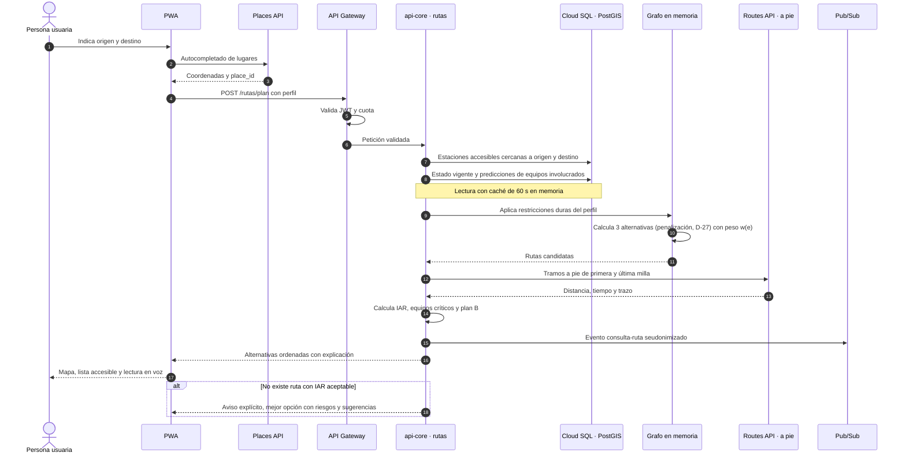
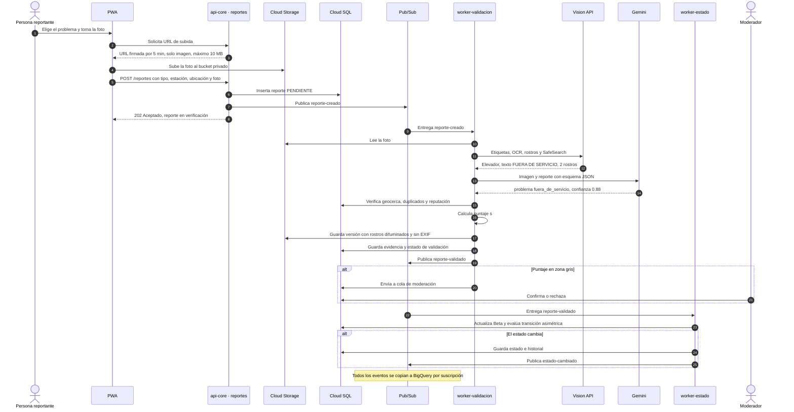
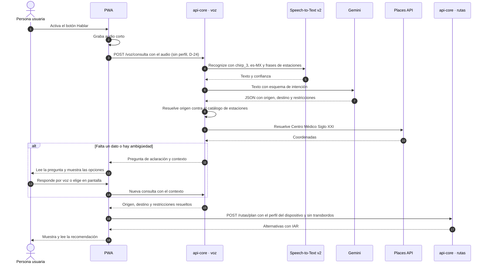
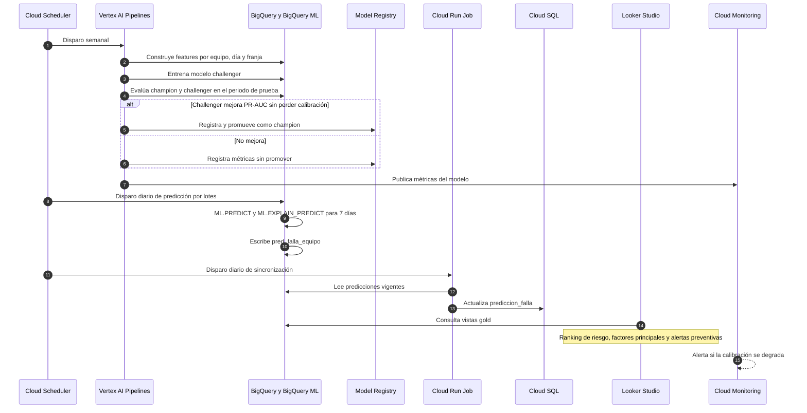

# 9. Flujos principales

Los ejemplos usan estaciones reales de la CDMX, pero **los estados de los equipos son hipotéticos** (avisos DEMO del escenario `data/demo/escenarios/flujo1.csv`, a partir de los cuales el estimador calcula los estados, D-21; los flujos 1 a 3 son la salida real del sistema con ese escenario) y sirven sólo para ilustrar el comportamiento del sistema. Las estaciones se eligieron para que coincidan con el inventario de demostración del corredor piloto (D-17), que respeta el indicador `wheelchair_boarding` del GTFS (D-19); los tiempos de viaje en tren provienen del GTFS publicado el 2026-08-28.

---

## Flujo 1. Búsqueda de una ruta accesible

**Escenario.** Mariana usa silla de ruedas manual. Quiere ir de su casa, cerca de la estación Tasqueña, al Museo de la Ciudad de México (Av. Pino Suárez 30, en el Centro Histórico). La ruta más rápida es la Línea 2 directa hasta Zócalo (19 min de tren y ~320 m a pie). Supongamos que el elevador de la salida de Zócalo tiene una **falla confirmada** desde ayer.

**Paso a paso (correspondencia con el enunciado)**

1. **El usuario indica origen y destino.** Por texto con autocompletado o con "mi ubicación". El perfil (silla manual: sin escalones, máximo 800 m a pie) viaja con la petición y no se registra en logs.
2. **El sistema consulta las estaciones y su estado.** PostGIS encuentra estaciones con acceso accesible a menos de 600 m del origen y del destino; se leen el estado vigente y las predicciones de sus equipos.
3. **El motor evalúa las alternativas.** Se eliminan las aristas que dependen del elevador de salida de Zócalo (falla confirmada). El método de penalización (D-27) calcula hasta tres rutas factibles y distintas usando el peso $w(e)$.
4. **El modelo recomienda la ruta más accesible.** Por ejemplo:
   - **A (recomendada, IAR 96)**: Línea 2 hasta **Pino Suárez** (una estación antes), salida José María Izazaga con elevador verificado hace 3 h, ~760 m a pie por Av. Pino Suárez (estimación local: línea recta × 1.3). Unos 5 minutos más que la ruta directa.
   - **B (IAR 96, con advertencia)**: Línea 2 hasta Pino Suárez, salida Pino Suárez, cuyo elevador tiene un dato de hace 30 h. Su IAR es igual al de A, pero la penalización por incertidumbre $u_e$ la deja en segundo lugar y la aplicación avisa "no se verifica desde hace 30 h".
   - **Descartada**: Línea 2 directa a Zócalo, con la explicación "el elevador de salida tiene falla confirmada y las demás salidas sólo tienen escaleras".
5. **La aplicación muestra el trayecto**, las estaciones, los equipos críticos con su última verificación, los posibles obstáculos y el plan B en cada punto crítico ("si el elevador de la salida José María Izazaga no funciona, usa el de la salida Pino Suárez").

### Qué recibe la persona al buscar (escenarios E1–E7)

Al pulsar "Buscar rutas accesibles" la respuesta cae siempre en uno de estos casos. Los ejemplos se obtuvieron con la red completa (D-25), el escenario sintético de estados y el perfil de silla de ruedas manual.

| # | Situación | Qué se muestra | Ejemplo |
|---|---|---|---|
| E1 | Hay ruta segura (IAR ≥ 70) | Hasta 3 alternativas distintas (D-27), cada una con IAR, equipos críticos, última verificación, plan B y botón "Ver mapa" | Balderas → Zapata: Línea 3 directa y dos por Metrobús |
| E2 | Hay ruta segura y otra mejor está bloqueada | E1 más "Rutas descartadas" con el motivo | Tasqueña → Museo de la Ciudad: se descarta la de Zócalo porque su elevador tiene falla confirmada |
| E3 | Hay rutas, pero la mejor tiene IAR < 70 | "No hay ruta segura hasta tu destino: la mejor disponible tiene un IAR de N…", las rutas como "Opciones con riesgo alto" y, aparte, las otras opciones | Cuando varios equipos de la ruta tienen posible falla |
| E4 | No hay ruta porque un equipo está en falla | Aviso, "Qué lo impide" (el equipo) y otras opciones, entre ellas "Ruta disponible cuando se repare el equipo" con su IAR | Terminal Aérea → Lechería: el elevador de la salida A de Lechería tiene falla confirmada |
| E5 | No hay ruta por una barrera física | Aviso, "Qué lo impide" y otras opciones; al final, "Ruta completa con asistencia del personal" con los puntos en rojo | Popotla → Zapata: Popotla sólo tiene escaleras (20 y 24 escalones) |
| E6 | Ninguna estación al alcance a pie del perfil | Se repite la búsqueda con caminatas de hasta 2 km; la ruta con asistencia marca "caminata de N m". A más de 2 km de toda estación, se dice que no hay estaciones al alcance | Un punto a 927 m de Estadio Azteca con el perfil de silla (máximo 800 m) |
| E7 | La estación no existe en la red | Error explícito ("Estación desconocida o fuera de la red") | Una clave de Trolebús o Cablebús, que están fuera del alcance |

**Otras opciones cuando no hay ruta segura (D-26).** Van siempre después del aviso, separadas de las alternativas y en este orden:

1. **Estación cercana**: ruta segura hasta la salida accesible más cercana al destino, con los metros que faltan.
2. **Si se repara**: la ruta que existiría si funcionaran los equipos que hoy la bloquean, con el IAR que tendría.
3. **Con asistencia**: siempre la última. Llega al destino, pero marca en rojo (símbolo, color y texto) cada estación y cada paso donde hace falta ayuda del personal y por qué ("Popotla: escalera con 20 escalones"). Es la única forma en que una ruta que viola una restricción dura del perfil sale del motor (regla de seguridad 3 precisada).

Las rutas por otros sistemas (Metrobús, Tren Ligero, trenes suburbanos) no son una opción aparte: con la red completa ya aparecen como alternativas normales.

---

## Flujo 2. Reporte de una falla

**Escenario.** Luis llega a la estación Pino Suárez y encuentra el elevador hacia el andén con cinta de restricción y un letrero de "fuera de servicio".

**Paso a paso**

1. **El usuario identifica el elevador fuera de servicio.** La PWA propone los equipos de la estación más cercana ("Elevador andén dirección Cuatro Caminos", "Elevador salida José María Izazaga") para que elija con un toque.
2. **Adjunta fotografía y ubicación.** La foto se sube directamente a Cloud Storage con una URL firmada; el backend nunca recibe el archivo, sólo su referencia.
3. **Vision API analiza la imagen**: detecta el elevador, lee el letrero "FUERA DE SERVICIO" y localiza dos rostros, que se difuminan. Gemini confirma que la imagen coincide con el reporte.
4. **El sistema clasifica el reporte**: con la evidencia visual (0.88), la ubicación dentro de la geocerca y la reputación de Luis (0.9), $s = 0.45 \cdot 0.88 + 0.25 + 0.15 \cdot 0.9 = 0.78$ → `VERIFICADO_AUTO`. Una persona nueva (reputación 0.5) con la misma foto obtendría $s = 0.72$: el reporte iría a corroboración y moderación, y el equipo pasaría igualmente a `FALLA_PROBABLE` (basta $s \ge 0.40$).
   > En modo local, Vision API y Gemini se sustituyen por un analizador simulado que reconoce las fotos sintéticas de `data/demo/fotos/` (D-23).
5. **Se actualiza el estado, sujeto a validación.** El estimador bayesiano pasa el equipo a `FALLA_PROBABLE`. Si en las siguientes horas otra persona confirma (o llega un aviso oficial), pasa a `FALLA_CONFIRMADA`. Para regresar a `OPERATIVO` se exigirá más evidencia (umbral asimétrico).
6. **Otros usuarios reciben información actualizada**: cualquier ruta calculada a partir de ese momento (con un máximo de 60 s de caché) ya considera el cambio. A quienes pasen cerca de Pino Suárez la app les pregunta "¿Sigue fuera de servicio este elevador?" para corroborar. En la versión futura, quien tenga una ruta guardada que pase por ese equipo recibirá una notificación.

---

## Flujo 3. Recomendación mediante voz

**Escenario.** Rosa, adulta mayor con andadera, vive cerca de la estación La Raza y dice: *"Quiero ir de La Raza al Centro Médico Siglo XXI, sin transbordos si se puede."*

> **D-24.** El endpoint de voz sólo interpreta: no recibe el perfil ni calcula la ruta. La PWA pide la ruta después, con el perfil guardado en el dispositivo, así el perfil nunca pasa por Speech-to-Text ni por Gemini (regla 6). Sólo se pregunta cuando falta el origen o el destino, cuando un lugar no se encuentra o cuando un nombre es de estaciones lejanas entre sí (Viaducto del Metro o del Metrobús, a 3.3 km); Buenavista o Tasqueña, con estaciones del mismo nodo, no se preguntan. En modo local, un intérprete por reglas y un transcriptor simulado sustituyen a Gemini y Speech-to-Text.

**Paso a paso**

1. **El usuario dicta su destino** con un botón grande, accesible por teclado y lector de pantalla.
2. **Speech-to-Text convierte la voz en texto.** La adaptación con nombres de estaciones evita confundir "La Raza" o "Tlatelolco".
3. **NLP interpreta la solicitud.** Gemini devuelve `{origen: "La Raza", destino: "Centro Médico Siglo XXI", restricciones: {max_transbordos: 0}}`. "Centro Médico" es ambiguo (también existe el Centro Médico Nacional La Raza, junto a la estación de origen): como el texto dice "Siglo XXI", se resuelve con Places API; si no lo dijera, la aplicación preguntaría.
4. **El motor procesa las preferencias de accesibilidad.** Se combinan las restricciones dichas en voz con el perfil guardado (andadera: evitar escaleras largas, tolerancia moderada a caminar). Línea 3 directa satisface "sin transbordos".
5. **Se presenta la recomendación** en pantalla y en voz: *"Te recomiendo la Línea 3 de La Raza a Centro Médico, sin transbordos. El elevador de La Raza fue verificado hace dos horas. En Centro Médico usa la salida Avenida Cuauhtémoc, que tiene rampa; el hospital está a unos 200 metros. Tiempo estimado: 27 minutos."*

---

## Flujo 4. Análisis predictivo

**Escenario.** Cada semana el sistema reentrena el modelo de fallas y cada noche actualiza las predicciones para los próximos 7 días.

**Paso a paso**

1. **Se recopilan datos históricos**: reportes, cambios de estado, afluencia, calendario y avisos llegan continuamente a BigQuery.
2. **BigQuery procesa la información**: limpia y construye la tabla de *features* por equipo, día y franja.
3. **Vertex AI analiza patrones**: la *pipeline* entrena, evalúa, compara y registra el modelo.
4. **El modelo identifica las estaciones con mayor probabilidad de problemas**: por ejemplo, "Elevador salida oriente de Pantitlán: 41 % de probabilidad de falla el viernes por la tarde; factores: 4 fallas en 30 días, alta afluencia, temporada de lluvias".
   > Nota (D-17): Pantitlán queda fuera del corredor piloto del MVP (Líneas 2 y 3); en la demostración el ejemplo usa una estación del corredor con elevadores, como Tasqueña o Pino Suárez. Pantitlán se incorpora en la Fase 9, con toda la red del Metro.
5. **El dashboard muestra indicadores y alertas preventivas**: ranking de equipos en riesgo, mapa de zonas críticas, MTTR por línea y evolución de la disponibilidad. Las mismas predicciones ya están en Cloud SQL para que el motor de rutas las use desde la mañana siguiente.
