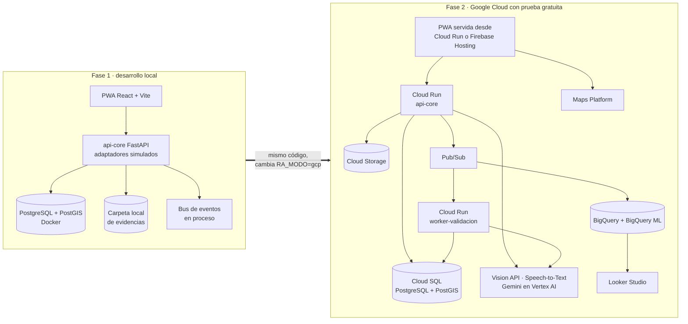

# 11–12. Arquitectura del MVP y tecnologías recomendadas

## 11. Arquitectura del MVP y funcionalidades prioritarias

### 11.1 Objetivo del MVP

Demostrar, en menos de dos semanas y con una persona desarrolladora, el **ciclo completo de valor**:

> Una persona en silla de ruedas pide una ruta → el sistema evita un elevador reportado en falla → otra persona reporta una falla con foto → la IA la verifica → el estado cambia → la siguiente ruta ya lo considera → el dashboard muestra el patrón y el riesgo predicho.

### 11.2 Restricciones del MVP

| Restricción | Consecuencia en el diseño |
|---|---|
| Plazo menor a dos semanas | Monolito modular, sin API Gateway, Pipelines simplificadas. |
| Sin cuenta de Google Cloud al inicio | **Patrón de adaptadores**: cada servicio externo tiene una interfaz con una implementación simulada (local) y una real (GCP), seleccionadas por configuración. Se desarrolla localmente y se conecta a GCP al abrir la prueba gratuita. |
| Laptop con 8 GB de RAM | Nada de OpenTripPlanner ni bases pesadas; el grafo con NetworkX en memoria es ligero; PostgreSQL + PostGIS en un solo contenedor. |
| No existe un inventario público de equipos | Inventario **de demostración** para un corredor piloto, con la misma estructura que el real y marcado explícitamente como datos de demostración. |
| No hay historial de fallas | Datos históricos **sintéticos** para entrenar y mostrar el modelo, identificados como tales. |

### 11.3 Alcance priorizado (MoSCoW)

| Prioridad | Funcionalidad | Módulo |
|---|---|---|
| **Debe** | Carga del GTFS de la CDMX (Metro, Metrobús, Tren Ligero) a PostGIS y construcción del grafo | B |
| **Debe** | Inventario de equipos de demostración para el corredor piloto | B, C |
| **Debe** | Perfiles de movilidad (silla manual, silla eléctrica, andadera, adulto mayor, carriola) | A |
| **Debe** | Planificador con restricciones duras, costo $w(e)$, 3 alternativas, IAR y explicación | B, D |
| **Debe** | Mapa con estaciones coloreadas y etiquetadas por estado, y vista en lista accesible | B |
| **Debe** | Reporte con foto y ubicación; verificación con Vision API + Gemini; estimador bayesiano de estado | C |
| **Debe** | Consulta por voz: Speech-to-Text + extracción de intención con Gemini | E |
| **Debe** | BigQuery con datos sintéticos, modelo de fallas en BigQuery ML y dashboard en Looker Studio | D, F |
| **Debe** | Despliegue en Cloud Run + Cloud SQL + Cloud Storage | — |
| **Debería** | Inicio de sesión con Identity Platform (simulado en local) | A |
| **Debería** | Consola de moderación y votos comunitarios | C, F |
| **Debería** | Pub/Sub real entre `api-core` y el trabajador de validación | C |
| **Debería** | Plan B por punto crítico y caché de la ruta para uso sin señal | B |
| **Podría** | Respuesta hablada con la síntesis de voz del navegador | E |
| **Podría** | Sugerencia de horario con mayor disponibilidad | D |
| **Podría** | Registro del modelo en Vertex AI Model Registry | D |
| **No en el MVP** | API Gateway, notificaciones push, GTFS-Realtime, ranking aprendido, clasificador de imágenes propio, navegación dentro de estaciones, Estado de México | — |

### 11.4 Diagrama del MVP

### 11.5 Patrón de adaptadores

| Puerto (interfaz) | Implementación local | Implementación GCP |
|---|---|---|
| `AlmacenEvidencias` | Carpeta en disco | Cloud Storage con URLs firmadas |
| `BusEventos` | Cola en proceso (tareas en segundo plano de FastAPI) | Pub/Sub |
| `AnalizadorImagen` | Respuestas simuladas deterministas | Vision API + Gemini |
| `TranscriptorVoz` | Texto fijo de prueba o archivo de transcripción | Speech-to-Text v2 |
| `InterpreteLenguaje` | Reglas simples con expresiones regulares | Gemini con salida estructurada |
| `Geocodificador` | Catálogo de estaciones + lista de lugares de prueba | Places API / Geocoding |
| `CaminataProveedor` | Distancia en línea recta × factor de rodeo | Routes API (modo a pie) |
| `ProveedorIdentidad` | Usuarios de desarrollo con JWT local | Identity Platform |

Una variable de entorno (`RA_MODO=local|gcp`) selecciona las implementaciones. Esto permite avanzar sin cuenta de nube, escribir pruebas automáticas reproducibles y presentar la demo aunque falle la conexión.

### 11.6 Plan de trabajo sugerido (≈ 12 días hábiles)

| Fase | Días | Entregable verificable |
|---|---|---|
| 0. Entorno | 1 | Repositorio con estructura, `docker compose up` levanta PostGIS, `pytest` y `npm run dev` funcionan |
| 1. Datos | 1–2 | GTFS cargado; consulta "estaciones a menos de 600 m" responde; inventario de demostración del corredor piloto |
| 2. Motor de rutas | 3–4 | `POST /rutas/plan` devuelve 3 alternativas con IAR; pruebas que demuestran que una falla confirmada desvía la ruta |
| 3. PWA | 4–6 | Búsqueda, perfil, mapa, lista accesible y detalle de ruta |
| 4. Reportes y estado | 6–7 | Reporte con foto en modo local; estimador bayesiano con umbrales asimétricos probado |
| 5. Voz | 8 | Consulta por voz extremo a extremo en modo local |
| 6. Nube | 8–9 | Cuenta de prueba abierta; Vision, Speech, Gemini y Maps reales; despliegue en Cloud Run + Cloud SQL + Cloud Storage |
| 7. Datos y ML | 9–10 | BigQuery con historial sintético, modelo BigQuery ML evaluado, predicciones en Cloud SQL, dashboard en Looker Studio |
| 8. Cierre | 11–12 | Guion de demostración, capturas, documento y presentación final |

El detalle por historias de usuario está en [`../mvp-backlog.md`](../mvp-backlog.md).

---

## 12. Tecnologías recomendadas

### 12.1 Frontend

| Necesidad | Tecnología | Motivo |
|---|---|---|
| Framework | **React + TypeScript** con **Vite** | Ecosistema amplio, tipado, arranque rápido |
| Instalable y uso sin señal | **PWA** con `vite-plugin-pwa` (service worker) | Una sola base de código para web y móvil; caché de la ruta activa |
| Componentes accesibles | **React Aria** (o Radix UI) + **Tailwind CSS** | Primitivas con roles ARIA, foco y teclado resueltos |
| Estado del servidor | **TanStack Query** | Caché, reintentos y estados de carga simples |
| Navegación | **React Router** | Estándar |
| Mapa | **Maps JavaScript API** mediante `@vis.gl/react-google-maps`; **Leaflet + OpenStreetMap** como respaldo en desarrollo local sin llave | Integración con React; desarrollo sin depender de la cuenta |
| Voz | **MediaRecorder** (captura) y **Web Speech API – SpeechSynthesis** (respuesta hablada) | Nativas del navegador |
| Pruebas | **Vitest**, **Playwright** y **axe-core** | Pruebas unitarias, de extremo a extremo y de accesibilidad automatizada |

### 12.2 Backend

| Necesidad | Tecnología | Motivo |
|---|---|---|
| Lenguaje | **Python 3.12** | Mismo lenguaje que el análisis de datos y el ML; bibliotecas cliente oficiales de Google Cloud |
| Framework web | **FastAPI** + **Pydantic v2** | Validación de datos, documentación OpenAPI automática, asincronía |
| Acceso a datos | **SQLAlchemy 2** + **GeoAlchemy2** + **Alembic** | ORM con soporte PostGIS y migraciones |
| Grafos | **NetworkX** (Dijkstra, `shortest_simple_paths` de Yen) | Suficiente para el tamaño de la red; fácil de explicar |
| GTFS | **pandas** + **gtfs-kit** (o lectura directa de los CSV) | Carga y validación del feed |
| Coincidencia de nombres | **RapidFuzz** | Resolver "Taxqueña/Tasqueña", "CU" contra el catálogo |
| Google Cloud | `google-cloud-storage`, `google-cloud-pubsub`, `google-cloud-vision`, `google-cloud-speech` (v2), `google-cloud-bigquery`, `google-genai` (Gemini en modo Vertex) | Bibliotecas cliente oficiales |
| Imágenes | **Pillow** (reescritura y borrado de EXIF, difuminado), **imagehash** (hash perceptual) | Saneamiento y detección de duplicados |
| Pruebas | **pytest** + **httpx** | Pruebas de API y del motor |
| Contenedores | **Docker** + **docker compose** | Mismo artefacto local y en Cloud Run |

### 12.3 Datos, ML e infraestructura

| Necesidad | Tecnología |
|---|---|
| Analítica y ML tabular | BigQuery SQL + BigQuery ML; scikit-learn para prototipos locales con datos sintéticos |
| Orquestación de ML | Consultas programadas de BigQuery en el MVP; Vertex AI Pipelines en la versión completa |
| Dashboard | Looker Studio |
| Despliegue | `gcloud run deploy` en el MVP; Cloud Build + Artifact Registry después |
| Infraestructura como código | Terraform (versión futura) |
| Control de versiones | Git + GitHub |
