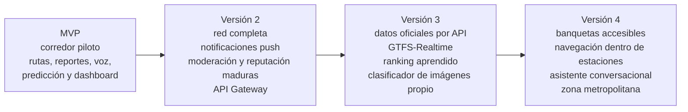

# 13–14. Limitaciones, riesgos y evolución futura

## 13. Posibles limitaciones y riesgos

### 13.1 Riesgos de datos

| Riesgo | Probabilidad | Impacto | Mitigación |
|---|:-:|:-:|---|
| **No existe un inventario oficial y consistente de elevadores y rampas** (las cifras públicas no coinciden) | Alta | Alto | Inventario propio curado y mantenido por la comunidad; buscar convenio con STC Metro y Metrobús; publicarlo como dato abierto de retorno. |
| **Arranque en frío**: sin reportes no hay estado vivo ni historial para entrenar | Alta | Alto | Estado `DESCONOCIDO` explícito; probabilidades base configurables; piloto acotado a un corredor con personas voluntarias; alianza con organizaciones de personas con discapacidad. |
| **GTFS desactualizado** respecto a cierres y obras (por ejemplo, las remodelaciones de Líneas 1 y 2) | Media | Alto | Capa de "cierres y avisos" que se superpone al GTFS; validación automática del feed en cada carga. |
| **Sesgo de reporte**: estaciones concurridas generan más reportes; estaciones periféricas, menos | Alta | Medio | Normalizar por afluencia; tratar la ausencia de reportes como incertidumbre, no como buen estado; incluir la tasa de reportes como variable de control en el modelo. |
| **Sesgo del modelo hacia zonas con más datos** | Media | Medio | Evaluar métricas por línea y por alcaldía; no publicar rankings sin intervalos de confianza. |
| **Tramos a pie no accesibles** (banquetas sin rampas, pendientes, comercio en vía pública) | Alta | Alto | Limitar distancia a pie por perfil; aviso explícito; permitir reportes de obstáculos en calle; datos de banquetas en versión futura. |

### 13.2 Riesgos de producto y operación

| Riesgo | Mitigación |
|---|---|
| **Participación comunitaria insuficiente** (pocas personas reportan) | Reporte en menos de 30 s; preguntas de corroboración de un toque; reconocimiento público de contribuciones sin depender de premios que incentiven reportes falsos. |
| **Reportes maliciosos o coordinados** | Puntaje de confianza, reputación, umbrales asimétricos, moderación (documento 07). |
| **Responsabilidad ante una recomendación equivocada** | Diez reglas de seguridad del documento 07; transparencia sobre fuentes y confianza; aviso de que la app no sustituye información oficial. |
| **La app misma no es accesible** | WCAG 2.2 AA como criterio de aceptación de cada pantalla; pruebas con personas usuarias reales. |
| **Conectividad limitada dentro de estaciones** | Caché de la ruta y planes B en la PWA; reportes en cola que se envían al recuperar señal. |

### 13.3 Riesgos técnicos y de proveedor

| Riesgo | Mitigación |
|---|---|
| **Costos variables** de Maps, Gemini y Vision al crecer el uso | IA sólo en el camino frío; caché permitida por los términos de uso; presupuesto con alertas; cuotas por API. |
| **Modelos en vista previa** (Chirp 3 para `es-MX`) o cambios de nombre y SDK (Vertex AI → Gemini Enterprise Agent Platform en 2026) | Adaptadores que aíslan cada proveedor; idioma de respaldo `es-US`; fijar versiones de modelos y revisar notas de versión. |
| **Dependencia de un solo proveedor de nube** | Contenedores estándar, PostgreSQL y SQL portable; la lógica del motor de rutas es propia. |
| **Términos de uso de Google Maps** (restricciones para almacenar contenido de Places) | Guardar sólo `place_id` y coordenadas permitidas; mostrar resultados de Places sobre mapas de Google. |
| **Privacidad de datos sensibles** | Consentimiento expreso, minimización, seudonimización y retención limitada (documento 07). |

### 13.4 Limitaciones del MVP (declaradas para la evaluación)

- El inventario de equipos y el historial de fallas son **de demostración y sintéticos**; las métricas del modelo en el MVP validan el flujo técnico, no la capacidad predictiva real.
- El corredor piloto no cubre toda la red.
- No hay notificaciones en tiempo real ni datos oficiales integrados por API.
- Los tramos a pie no consideran el estado de las banquetas.

---

## 14. Evolución futura de la plataforma

### Versión 2 — consolidación

- Cobertura de toda la red de Metro, Metrobús y Tren Ligero; incorporación de Trolebús, Cablebús y RTP.
- **Notificaciones push** (Firebase Cloud Messaging) cuando cambia el estado de un equipo en una ruta guardada.
- **API Gateway** con cuotas por consumidor; Cloud Armor si el tráfico lo justifica.
- Vertex AI Pipelines completas con monitoreo de deriva y promoción automática *champion/challenger*.
- Puntaje de confianza de reportes **aprendido** con los datos de moderación.

### Versión 3 — integración institucional e inteligencia

- **Convenio con STC Metro y Metrobús** para recibir por API los avisos de mantenimiento y el estado de equipos (y, en el futuro, telemetría de sensores en elevadores vía Pub/Sub).
- **GTFS-Realtime de Metrobús** para tiempos de espera reales.
- **Aprendizaje de ranking** en Vertex AI con la retroalimentación de viajes completados.
- **Clasificador de imágenes propio** entrenado con las fotos validadas.
- **Publicación de datos abiertos de retorno**: inventario de equipos y archivo `pathways.txt` enriquecido para el GTFS de la ciudad.
- Cloud Text-to-Speech para instrucciones habladas más naturales; reconocimiento de voz en *streaming*.

### Versión 4 — viaje de puerta a puerta

- **Ruteo peatonal accesible** con datos de banquetas (iniciativas abiertas como OpenSidewalks y reportes propios de obstáculos en calle).
- **Navegación dentro de estaciones** paso a paso (pasillos, elevadores, salidas) usando el modelo de *pathways*.
- **Asistente conversacional** con agentes de Gemini Enterprise Agent Platform: "avísame si el elevador de mi estación de regreso falla antes de las 6".
- Expansión a la zona metropolitana (Mexibús, Tren Suburbano, Tren Interurbano) y a otras ciudades con GTFS (Guadalajara, Monterrey).
- **API pública** para que otras apps de movilidad consuman el estado de accesibilidad.
